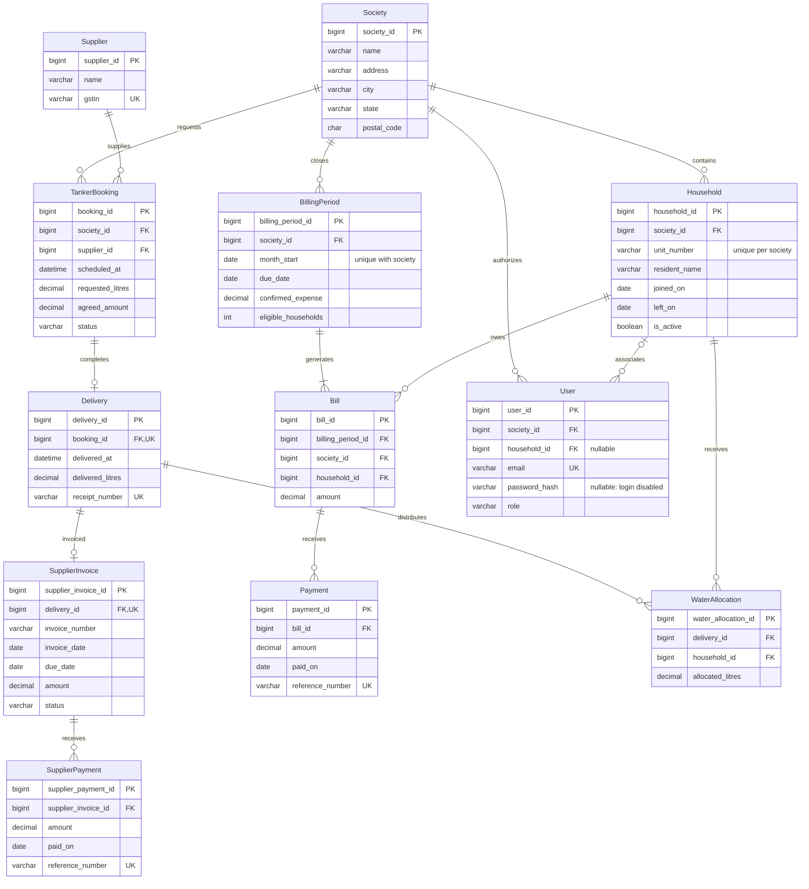

# WASSER database — Phase 2

Requires MySQL **8.0.16+** with InnoDB and strict SQL mode. Monetary values are INR, stored as DECIMAL; litres are DECIMAL. Times are local society wall-clock times (Indian sample societies use IST).



## Model and rules

The 11 requested entities are separate tables. `BillingPeriod` adds a monthly expense and eligibility snapshot, keeping those facts out of individual household bills. Supplier invoices describe actual confirmed expenses; booking amounts are quotations. One invoice per delivery is supported. `invoice_number` is a display reference; the internal invoice ID and unique delivery identify an invoice. Consolidated supplier invoices and credit notes are future extensions.

Tables are in 3NF where practical. `Bill.society_id` is deliberate controlled redundancy: two composite foreign keys prevent a household from receiving another society's bill. User membership uses the same technique. Balances and paid statuses are derived in `HouseholdBalance` and `SupplierInvoiceBalance`; they are not stored and cannot drift as partial payments accumulate. Indexes cover foreign keys, monthly invoice selection, active household selection, scheduled bookings, and payment histories.

Booking transitions are `REQUESTED → CONFIRMED → DISPATCHED → DELIVERED`, with cancellation allowed only from REQUESTED or CONFIRMED. Insert bookings as REQUESTED. Insert a delivery only after dispatch; its trigger marks the booking DELIVERED. Delivered and cancelled states are terminal. Receipts are immutable. Supplier invoices may start confirmed, or move from DRAFT to CONFIRMED/VOID; confirmed/void invoices are immutable. Positive amounts/volumes and date checks are enforced. Deletes use restrictive foreign keys; there are no cascading record deletes.

Payments are append-only, positive, and limited to their parent balance. Parent-row locks serialize concurrent payments, with locking balance reads to avoid stale repeatable-read snapshots. Water allocation also locks its delivery, checks society membership, and prevents allocating more litres than received. Unallocated litres are allowed. Allocation volumes do not change the equal-cost billing rule.

## Monthly billing

Call the procedure **outside an existing transaction**:

```sql
CALL GenerateMonthlyBills(1, '2026-11-01', '2026-12-10');
```

Replace `1` with the real society ID. It totals CONFIRMED invoices whose **invoice_date** is in the requested month. Each invoice necessarily has a delivery. Supplier payment dates do not affect the billed expense. Eligible households are currently active and have a residency interval overlapping that month (`joined_on <= month end`, `left_on` absent or at least month start). The policy includes a household joining midmonth with a full equal share. For retrospective billing, maintain household activity/dates appropriately before generation; this version does not keep a historical occupancy ledger.

The procedure locks the society, checks for duplicate generation, locks eligible household rows, records the snapshot, and inserts all bills in one transaction. Bills sum exactly to confirmed expenses: integer paise are divided equally, and leftover paise go to ascending household IDs. The largest and smallest bills differ by at most INR 0.01. No households or no expenses causes a clear error rather than empty billing. A unique society/month period and unique period/household bill prevent duplicates.

Invoice inserts/updates/deletes lock the same society row and reject changes in an already billed invoice month, so late expenses must be resolved **before** generation. Snapshot periods and bills are immutable. Corrections after closing need a separately designed audited adjustment/credit-note process; do not edit closed financial records. Concurrent operations may produce an InnoDB deadlock; an application should retry the entire failed transaction.

Application code must generate bills through `GenerateMonthlyBills`, rather than direct inserts into Bill/BillingPeriod, to enforce the equal-distribution workflow. For production, use a separate migration account and restrict the runtime account to required SELECT/INSERT and procedure EXECUTE privileges; the current development account has broad privileges. Database ownership is not an authorization boundary. API authentication, role enforcement, and secure password hashing are later backend work.

## Installation and verification

Preserved `database/001_create_database.sql` unchanged. The schema targets the existing `wasser` database and contains no DROP, TRUNCATE, ALTER, or record deletion. Installation is **one-time**, not a migration system. MySQL DDL implicitly commits: a failed installation can leave some created objects. Inspect them before recovery; do not rerun or drop objects blindly.

From the repository root in PowerShell, the included runner loads the existing server environment without displaying credentials:

```powershell
node server/scripts/run-sql.js schema.sql
node server/scripts/run-sql.js seed.sql
node server/scripts/run-sql.js queries.sql
npm.cmd run db:check
```

Run each command only after the preceding one succeeds. The runner refuses schema installation in a nonempty database and refuses repeat demo seeding. `seed.sql` contains fictional data and uses generated IDs, with example.invalid email addresses and NULL password hashes (no usable seeded logins). Seed installation has several transactions because monthly generation owns its transaction; failure after a commit requires inspection rather than blind repetition.

Alternatively, connect with MySQL CLI from the repository root; `-p` prompts for the password:

```powershell
mysql -h localhost -P 3306 -u wasser_app -p wasser
```

Inside that client, execute each line after the previous succeeds:

```sql
SOURCE database/schema.sql;
SOURCE database/seed.sql;
SOURCE database/queries.sql;
SHOW FULL TABLES;
SELECT TABLE_NAME FROM information_schema.TABLES
WHERE TABLE_SCHEMA = 'wasser' AND TABLE_TYPE = 'BASE TABLE'
ORDER BY TABLE_NAME;
SELECT ROUTINE_NAME FROM information_schema.ROUTINES WHERE ROUTINE_SCHEMA = 'wasser';
SHOW TRIGGERS FROM wasser;
```

The native client's SOURCE command may continue after individual statement errors. Inspect its output and confirm the full object inventory before sourcing seed.sql; the Node runner stops on the first error and checks the trigger/procedure prerequisites before seeding.

Expect **12 base tables, 2 views, 2 procedures, and 22 triggers**. The demo has two societies, six households (five active), three delivered tankers, one pending booking, three confirmed invoices, and five bills. Pune's October expense is INR 9,000.01, split into 3,000.01 / 3,000.00 / 3,000.00. Bengaluru's INR 3,200.00 splits into two INR 1,600.00 bills. Household payments total INR 3,100.00; supplier payments total INR 2,000.00. Every reconciliation difference in queries.sql should be 0.00. The LEFT JOIN shows the inactive household with no bill.

## Binary logging privilege prerequisite and safe recovery

On this local server, initial installation reached the first trigger and failed with:

```text
ER_BINLOG_CREATE_ROUTINE_NEED_SUPER:
You do not have the SUPER privilege and binary logging is enabled
(you *might* want to use the less safe log_bin_trust_function_creators variable)
```

The server has `log_bin=1` and `log_bin_trust_function_creators=0`. This is a server privilege requirement, not an application credential failure. Tables and views already exist; do not delete or recreate them. An administrator can run the reviewed trigger definitions using an appropriately privileged migration account. Alternatively, for this local development server, an administrator can explicitly allow routine/trigger creators:

```sql
-- Administrator action only; not executed automatically by WASSER.
SET GLOBAL log_bin_trust_function_creators = 1;
```

That setting changes server-wide binary-logging trust policy until restart or another change. Have the administrator decide whether it is appropriate; granting SUPER to the runtime account is unnecessary. After the administrator resolves the prerequisite, resume additive installation:

```powershell
node server/scripts/run-sql.js schema.sql --resume
node server/scripts/run-sql.js seed.sql
node server/scripts/run-sql.js queries.sql
node server/scripts/check-phase2.js
```

`--resume` preserves objects already present and creates only missing ones. Use it only for recovery of this reviewed installation: it does not compare definitions or migrate existing objects. Seeding refuses to run until all 22 triggers and both procedures exist. No administrator setting or privilege grant was executed during this implementation.

## Actual execution report — 15 November 2026

| Script/check | Result |
| --- | --- |
| Existing `001_create_database.sql` | Inspected and preserved; not executed |
| `schema.sql` | Partially executed: 12 tables and 2 views created; stopped at first trigger with ER_BINLOG_CREATE_ROUTINE_NEED_SUPER |
| `seed.sql` | Not executed; no sample records inserted |
| `queries.sql` | All 10 statements executed successfully against the empty tables; business reports returned no rows |
| `check-db.js` | Passed: MySQL 8.0.46 connected to wasser |
| JavaScript syntax checks for new runners | Passed |
| `check-phase2.js` | Failed as expected on incomplete inventory: 0 of 22 triggers installed; 0 of 2 procedures installed |

Full billing and constraint verification is **pending**, not passed. The verifier checks installed object counts, reconciliation and equal shares, and rejects invalid transitions, overpayments, closed-month invoice changes, and duplicate monthly generation. Its negative DML checks use rollback and do not delete existing records. Run it after safe installation resumption and demo seeding. No destructive schema statements, credential changes, privilege changes, commits to Git, or pushes were performed.
